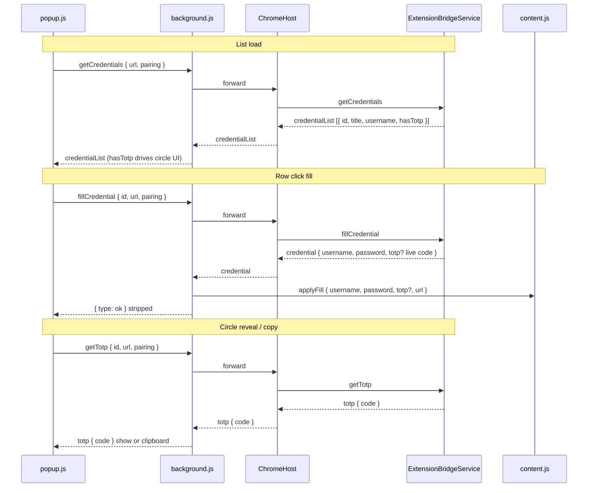

# Chrome Extension — TOTP/2FA Autofill and Privacy Circle

**Date:** 2026-08-01  
**Status:** Approved

Follow-up to [2026-07-25-mypass-phase4-chrome-extension-design.md](./2026-07-25-mypass-phase4-chrome-extension-design.md) and [2026-08-01-chrome-extension-popup-list-redesign-design.md](./2026-08-01-chrome-extension-popup-list-redesign-design.md). Implements **piece A only**: TOTP autofill on user-initiated row click plus a popup privacy circle for reveal/copy. Does **not** include piece B (2FA setup / QR capture in the extension) or piece C (Passkeys).

## Problem

Phase 4 Chrome autofill fills username and password only. Entries with TOTP secrets in MyPass cannot complete a two-step login from the browser: the user must switch to the macOS app to read or copy the code. The popup list redesign ([popup list redesign spec](./2026-08-01-chrome-extension-popup-list-redesign-design.md)) improved row visuals but still exposes no 2FA affordance. `ExtensionBridgeService.fillCredential` intentionally returns `totp: nil` today, and `content.js` has no OTP field detection — a deliberate security hold until a full design existed.

## Goals

- **Autofill TOTP on explicit user action** — row click sends `fillCredential`; the app computes a **live** six-digit code via `TOTPCode` and returns it in the `credential.totp` field (never the Base32 seed). `content.js` fills an OTP input when one is detected on the page.
- **Graceful partial fill** — fill username/password only when those fields exist; fill TOTP only when an OTP field exists; on OTP-only pages, fill TOTP alone. If no OTP field is present, ignore `totp` in the fill payload (code remains available via the privacy circle).
- **Popup privacy circle** — for list entries with `hasTotp: true`, show a circle on the right side of the row: masked by default; left-click reveals digits via a new `getTotp` message; right-click / trackpad two-finger tap (`contextmenu`) copies to clipboard. Auto-hide after ~5 s, on second click, or click outside.
- **List metadata** — `getCredentials` includes `hasTotp` per entry so the popup can render the circle without requesting secrets.
- **Security preserved** — pairing + loopback token + domain match gates unchanged; Base32 secret never leaves the app; `fillCredential` response to the popup still strips username/password/totp (`stripCredentialSecrets` → `{ type: "ok" }`); popup receives a TOTP string only through `getTotp`.
- **Popup close unchanged** — after row click fill, popup closes as today. The privacy circle is always visible in the list for TOTP entries; the user reopens the popup on the OTP page themselves when needed.

## Non-goals

- **Piece B** — saving or setting up 2FA from the extension (QR scan, manual secret entry, otpauth import).
- **Piece C** — Passkeys / WebAuthn autofill or registration from the extension.
- **Auto-wait next-page fill** — no automatic fill after navigation from login to OTP step; user reopens popup and clicks again.
- **Countdown ring** in the popup circle (macOS detail view has a live ring; popup shows static digits when revealed).
- **Safari** extension parity — Chrome only in this spec.
- **Badge** indicator on the extension icon for TOTP-capable matches.
- **Auto-fill on page load** — filling remains user-initiated only (popup row click).

## Design

### Scope boundary

| Piece | Description | In this spec |
|-------|-------------|--------------|
| **A** | TOTP autofill + popup privacy circle | **Yes** |
| **B** | 2FA setup / QR in extension | No |
| **C** | Passkeys | No |

### User-visible behavior

1. **Combined login + OTP page** — user clicks a credential row → `fillCredential` runs → username and password fill when login fields exist; TOTP fills **only** if `findOtpField` finds a candidate on the page. If no OTP field, `totp` is ignored; user may reopen popup and use the privacy circle.
2. **Login-only page** — same as today for username/password; TOTP ignored on fill (no OTP field). Circle still visible for entries with `hasTotp`.
3. **OTP-only page** — row click fills **only** TOTP; missing username/password fields are skipped without error.
4. **After fill** — popup closes immediately (unchanged). Circle does not trigger fill; it is for reveal/copy while the popup stays open.
5. **Privacy circle** — no digits by default (idle). Left-click → `getTotp` → show six digits (revealed). Right-click / `contextmenu` → `getTotp` → copy to clipboard + brief copied flash. Hide on second left-click on the circle, click outside the circle, or auto-hide timer (~5 s). On `getTotp` failure, stay idle (no error toast in v1).

### Architecture & data flow

**Trust model** (unchanged from Phase 4 + pairing):

- Browser extension ↔ ChromeHost via native messaging (`allowed_origins` restricted to extension ID).
- ChromeHost ↔ MyPass app via loopback TCP + per-session Keychain token.
- Pairing secret required for `getCredentials`, `fillCredential`, and `getTotp`.
- Entry domain must match tab URL on app side (`ExtensionEntryMatcher`) and again in `background.js` / `content.js` before secrets or codes reach the page.

**Approach 1 (approved):**

| Surface | TOTP data |
|---------|-----------|
| `getCredentials` list | `hasTotp: Bool` only — no code, no secret |
| `fillCredential` → content script | Live six-digit `totp` string when entry has a secret |
| `getTotp` → popup | Live six-digit code for reveal/copy |
| Never | Base32 seed / `totpSecretBase32` to extension |

**Messages**

| Message | Direction | Payload | Response |
|---------|-----------|---------|----------|
| `getCredentials` | popup → app | `url`, optional `pairing` | `{ type: "credentialList", credentials: [{ id, title, username, hasTotp }] }` or locked / pairingRequired / error |
| `fillCredential` | popup → app → tab | `id`, `url`, optional `pairing` | Native: `{ type: "credential", username, password, totp? }`. Popup callback: `{ type: "ok" }` after `stripCredentialSecrets`. Tab: `{ type: "applyFill", username, password, totp?, url }` |
| `getTotp` | popup → app | `id`, `url`, optional `pairing` | `{ type: "totp", code: "<digits>" }` or locked / pairingRequired / error |

**Invariant:** `fillCredential`'s async response to `popup.js` never includes `username`, `password`, or `totp`. The popup obtains a TOTP string **only** via `getTotp`. Live `totp` on the native `credential` response is relayed exclusively to `content.js` through `applyFill`.



### OTP detection & applyFill

**New in `content.js`:** `findOtpField()` scans `document` (not limited to a login `<form>`) and returns the highest-scoring visible, enabled `<input>` or `<textarea>`.

**Scoring priorities** (higher wins; tie-break: first in document order):

| Priority | Signal | Score |
|----------|--------|-------|
| 1 | `autocomplete="one-time-code"` (case-insensitive) | +10 |
| 2 | `name` or `id` matches `/otp|totp|2fa|two.?factor|verification.?code|auth.?code|security.?code/i` | +6 |
| 3 | `inputmode="numeric"` and `maxlength` in {6, 7, 8} | +4 |
| 4 | `type="tel"` or `type="text"` (and not already chosen as username) | +1 |

Exclude `type="password"`, `type="hidden"`, disabled, or `readonly` inputs. Export `scoreOtpLikeness`, `findOtpField`, and updated `applyFill` logic for unit tests.

**`applyFill` behavior**

| Field on page | Message field | Action |
|---------------|---------------|--------|
| Username input found | `username` non-empty | Fill username |
| Password input found | `password` non-empty | Fill password |
| OTP input found (`findOtpField`) | `totp` non-empty | Fill OTP |
| OTP input **not** found | `totp` present | **Ignore** `totp` |
| Username/password **not** found | `username` / `password` present | **Skip** silently (OTP-only page OK) |

**Login form detection** — keep existing `findLoginForm()` for username/password. **`applyFill` must not require** a login form: if `findLoginForm()` returns null but `findOtpField()` returns an input, still apply TOTP when provided.

**No auto-fill on load** — unchanged; `applyFill` runs only after explicit popup row click via `background.js` relay.

### Popup privacy circle

**Placement:** trailing (right) edge of each credential row when `credential.hasTotp === true`. Row layout: `[ avatar | title column | circle ]`. Circle does not shift letter-avatar alignment from the popup redesign spec.

**Visual states**

| State | Appearance |
|-------|------------|
| **idle** | Empty circle or neutral dot — **no digits** |
| **revealed** | Six-digit code centered in circle (monospace, ~11–12 px) |
| **copied flash** | Brief “Copied” label or checkmark (~1 s), then return to idle |

**Gestures**

| Gesture | Handler | Row fill |
|---------|---------|----------|
| Left-click circle | `getTotp` → revealed; second left-click → idle | **No** — `stopPropagation()` on circle mousedown/click |
| Right-click / `contextmenu` on circle | `preventDefault()` + `getTotp` → `navigator.clipboard.writeText` → copied flash | **No** |
| Click row (outside circle) | Existing `fillCredential` + `window.close()` | **Yes** |

**Hide rules:** (a) second left-click on same circle, (b) `document` click outside circle while revealed, (c) auto-hide timer **~5 s** after reveal or copy. Timer resets on each reveal/copy.

**Errors:** if `getTotp` returns locked, pairingRequired, or error — circle stays **idle**; no inline error copy in v1.

### App / bridge

**`ExtensionCredentialSummary`** (`ExtensionBridgeKit`):

```swift
public struct ExtensionCredentialSummary: Codable, Equatable {
    public let id: String
    public let title: String
    public let username: String
    public let hasTotp: Bool
}
```

Populate `hasTotp` from `entry.totpSecretBase32?.isEmpty == false` in `getCredentials`.

**`fillCredential`** — after domain + id match:

- Compute live code when secret present: `TOTPCode.currentCode(secretBase32:, digits: 6, period: 30, algorithm: .sha1, now: Date())`.
- Return `.credential(username:, password:, totp: liveCodeOrNil)` — **never** the Base32 string.
- Keep `onCredentialFilled` and `touchAccess` on success.

**New `getTotp`** — request `{ type: "getTotp", token, id, url, pairing? }`:

- Same authorization gates as `fillCredential` (pairing, unlocked vault, entry id + URL domain match).
- Response `{ type: "totp", code: "<digits>" }` or standard error shapes.
- Does **not** call `touchAccess` (reveal/copy is lighter than a full fill; optional follow-up if product wants parity with app copy actions).

**`ExtensionBridgeRequest` / responses** — add `.getTotp(token:id:url:pairing:)` and `.totp(code: String)` response case with Codable wiring in `ExtensionBridgeMessages.swift`. ChromeHost forwards opaquely (no TOTP logic in host).

**Tests to replace / add**

- **Replace** `testFillCredentialNeverReturnsTotpEvenWhenEntryHasOne` — that test enforced `totp: nil`; new behavior returns a **live code** (assert non-nil, six digits, matches `TOTPCode.currentCode` for fixture secret at frozen `Date` if injectable, or pattern match).
- Add `testFillCredentialReturnsNilTotpWhenEntryHasNoSecret`.
- Add `testGetCredentialsSetsHasTotpTrueWhenSecretPresent` / `false` when absent.
- Add `testGetTotpReturnsLiveCodeForMatchingEntry`.
- Add `testGetTotpRejectsDomainMismatch`, locked vault, missing pairing (mirror fillCredential negative cases).

**`background.js`**

- Add `"getTotp"` to `knownTypes`.
- Route `getTotp` through `sendNativeMessageWithPairing`; return response **without** stripping (code is ephemeral, popup-only).
- `fillCredential` path unchanged: `relayFillToActiveTab` + `stripCredentialSecrets` for popup callback.

**`popup.js`**

- Render circle when `hasTotp`.
- Wire circle handlers (`getTotp`, clipboard, hide timer, `stopPropagation`).
- Export testable helpers: `shouldShowTotpCircle(hasTotp)`, hide-timer/state helpers as needed.

### Out of scope

Explicitly deferred (not piece A):

- 2FA save / setup / QR scanning in extension (piece B).
- Passkeys (piece C).
- Auto-wait and fill on next page after login redirect.
- Animated countdown ring in popup circle.
- Safari extension.
- Extension icon badge for TOTP entries.
- Unlock-from-extension or other popup shell changes beyond circle affordance.

## Files touched

| Path | Change |
|------|--------|
| `Packages/ExtensionBridgeKit/Sources/ExtensionBridgeKit/ExtensionBridgeMessages.swift` | **Edit** — `hasTotp` on summary; `getTotp` request; `totp` response |
| `Packages/ExtensionBridgeKit/Tests/ExtensionBridgeKitTests/ExtensionBridgeMessagesTests.swift` | **Edit** — encode/decode for new fields |
| `MyPass/State/ExtensionBridge/ExtensionBridgeService.swift` | **Edit** — `hasTotp`, live TOTP on fill, `getTotp` handler |
| `MyPass/State/ExtensionBridge/LoopbackServer.swift` | **Edit** — route `getTotp` token extraction if needed |
| `MyPassTests/ExtensionBridgeServiceTests.swift` | **Edit** — replace forbid-totp test; add hasTotp / getTotp tests |
| `ChromeExtension/content.js` | **Edit** — `findOtpField`, OTP-aware `applyFill`, OTP-only path |
| `ChromeExtension/background.js` | **Edit** — `getTotp` routing |
| `ChromeExtension/popup.js` / `popup.html` | **Edit** — privacy circle UI + handlers |
| `ChromeExtension/tests/*.test.js` | **Edit** — OTP scoring fixtures; circle helper tests |
| `RUN.md` | **Edit** — manual e2e bullets (see below) |

**Out of touch:** pairing protocol shape (only new message type), save-proposal flow, ChromeHost business logic beyond forward, macOS TOTP entry UI.

## Acceptance criteria

1. **`hasTotp`** — `getCredentials` returns `hasTotp: true` when entry has non-empty `totpSecretBase32`; false otherwise. No secret or code in list payload.
2. **Fill with OTP field** — row click on page with login + OTP inputs fills all three when entry has secret; popup receives `{ type: "ok" }` only.
3. **Fill without OTP field** — row click fills username/password; `totp` not written to DOM; no error.
4. **OTP-only page** — row click fills TOTP only; no console errors for missing password field.
5. **Privacy circle idle** — no digits visible until left-click reveal.
6. **Reveal** — left-click fetches via `getTotp`, shows six digits, auto-hides ~5 s.
7. **Copy** — right-click / contextmenu copies code, shows copied flash, does not trigger row fill.
8. **Circle vs row** — circle clicks do not send `fillCredential`; row click still fills and closes popup.
9. **Security** — no Base32 in any extension message; domain mismatch blocks fill and getTotp; `stripCredentialSecrets` still applies to fillCredential popup response.
10. **Tests** — JS OTP scoring tests pass; Swift hasTotp / live fill totp / getTotp tests pass; removed obsolete forbid-totp test.

## Testing

### Automated

**JavaScript** (`ChromeExtension/tests/`)

- `scoreOtpLikeness` / `findOtpField` on HTML fixture strings: `autocomplete="one-time-code"` wins over generic text input; name/id pattern cases; numeric `inputmode` + maxlength; OTP-only document without password field.
- Popup circle helpers: state transitions idle → revealed → idle; copied flash timing mocked; `stopPropagation` behavior documented via handler unit tests where feasible.

**Swift** (`MyPassTests/ExtensionBridgeServiceTests.swift`, `ExtensionBridgeKitTests`)

- `hasTotp` true/false on `getCredentials`.
- `fillCredential` returns live six-digit `totp` when secret set; `nil` when absent.
- **Replace** `testFillCredentialNeverReturnsTotpEvenWhenEntryHasOne` with live-code assertions (never Base32 substring in response).
- `getTotp` success + negative cases (wrong domain, locked, unauthorized pairing, unknown id).

Run via `./scripts/test.sh`.

### Manual e2e notes (add to `RUN.md` Chrome section)

Add bullets under **Chrome e2e (ручна перевірка)**:

- [ ] Entry with TOTP shows privacy circle in popup list (`hasTotp`); circle shows no digits until clicked.
- [ ] Login page row click fills username + password; TOTP not injected when page has no OTP field.
- [ ] Page with OTP input: row click fills OTP when entry has TOTP secret.
- [ ] OTP-only fixture page: row click fills verification code without username/password fields.
- [ ] Left-click circle reveals code; hides after ~5 s or outside click.
- [ ] Right-click circle copies code to clipboard (paste verifies).
- [ ] Circle click does not close popup or trigger autofill; row click still fills and closes popup.

Use fixture HTTP server on port 8765; add or reuse an OTP input fixture page as needed for the OTP-only and combined cases.

## Follow-ups

- **Piece B** — extension-side 2FA setup (QR / manual secret) with app-side vault write.
- **Piece C** — Passkeys autofill and registration bridge.
- **Auto-wait next page** — optional chained fill after navigation (higher complexity, phishing considerations).
- **Popup countdown ring** — visual parity with macOS `TOTPCountdownRingView`.
- **touchAccess on getTotp** — align extension copy with app “last accessed” semantics if desired.
